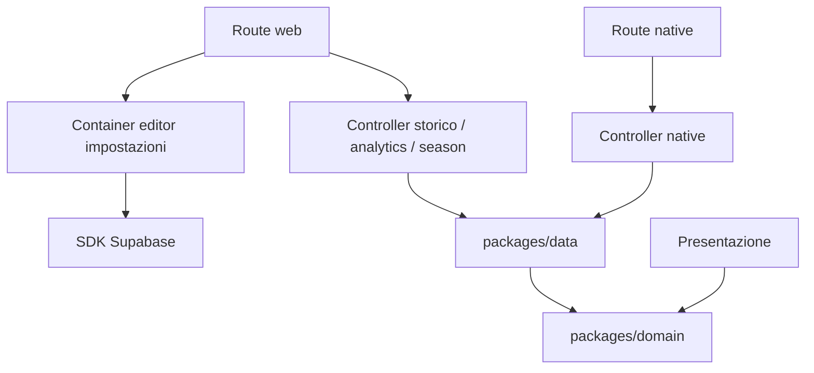

# DEV26 — Architettura e responsabilità

Versione candidata 9.3.0; base Dev bac40b9c. Documento di lavoro: **refactoring delle schermate parziale**, non attestazione di completamento del punto6.

## Confini già introdotti

`packages/domain` contiene un'unica implementazione di win rate, identità partecipanti e visibilità ranking. Web e mobile mantengono adapter ai percorsi precedenti. Nessuna dipendenza React/Next/Expo/Supabase/storage nel dominio. Il controllo AST `verify-domain-boundaries.mjs` rifiuta import esterni, accesso a globali di piattaforma e cicli; entrambi i quality lo invocano.

Coverage: mantenute le soglie dei vecchi adapter e aggiunte le stesse soglie alle implementazioni condivise. Il mobile raccoglie esplicitamente coverage dei file esterni tramite percorso assoluto e allowExternal; senza questa configurazione Vitest ometteva i file e il ratchet ha correttamente fallito. Non sono state abbassate soglie.

## Proprietari attuali e destinazione

| Proprietario attuale | Responsabilità da separare | Confine desiderato |
|---|---|---|
| app/table/[id]/page.tsx | catalogo/membership, match editor, storico, analytics, inviti | controller per feature e route compositiva |
| app/profile/page.tsx | ricerca/import carte, catalogo mazzi, editing, premi, analytics | servizi ricerca/import, controller collezione, pannelli |
| components/live-game/web-live-game.tsx | setup, journal, sync, lifecycle, dialoghi, finalizzazione | controller lifecycle/sync, UI tavolo e dialoghi |
| expo/app/table/[id]/play.tsx | stato locale, outbox, listener, setup, finalizzazione e rivincita | controller equivalenti con adapter nativi |

Le estrazioni sono parziali e non soddisfano ancora i quattro target dimensionali. Non trasferire ogni riga in un unico useController: ogni query/subscription/journal deve avere un proprietario unico con cleanup e contratto documentati.

## Punti di manutenzione già unificati

- Regola win rate: packages/domain/win-rate.ts, usata da entrambi i client.
- Identità utente/ospite: packages/domain/participant-keys.ts.
- Soglia provvisoria e filtro: packages/domain/deck-ranking-visibility.ts.

Restano da dimostrare i percorsi recap, errore sync e setup richiesti da11d, i lifecycle account/gruppo e i limiti dimensionali delle quattro schermate. Non dichiarare completato DEV26-11/12 con il solo dominio comune.

## Confini aggiunti durante il rafforzamento sync

`packages/domain/live-game-sync-presentation.ts` possiede gli stati e i conteggi condivisi, la classificazione degli errori di autenticazione e le istruzioni IT/EN. Il cambio di significato di un errore sync ha ora un punto comune ai client, coperto dalle rispettive suite. `WebSyncBadge` possiede esclusivamente i timer di visibilità/annuncio e la presentazione; non accede a Supabase o al journal. L'adapter storage web delega la validazione al contratto separato e conserva tipi di compatibilità. Il writer nativo serializza le scritture e preserva gli errori per i chiamanti che richiedono durabilità; il controller resta proprietario della catena e della sessione.

Questi sono confini preparatori necessari a DEV26-05. Non sostituiscono la scomposizione dei quattro target, l'audit dei lifecycle o le prove di manutenzione11d. Nessuna riduzione globale delle responsabilità delle quattro schermate è ancora certificata.

## Baseline strutturale misurata (AST)

| Target | Righe non vuote | useState | useEffect |
|---|---:|---:|---:|
| Tavolo web |4159|75|13|
| Profilo web |3555|63|10|
| Partita web |1718|43|15|
| Partita mobile |2140|37|12|

Inventario dettagliato in artifacts/dev26/architecture-before.json (locale ignorato). Il successivo step profilo estrae richieste/contratti e rimuove scansioni raw e fallback; `use-profile-metrics`, i moduli condivisi `profile-catalog-*` e le API admin possiedono ora questi confini. Questo avanzamento non costituisce ancora la misura dopo e le prove11d dell'intero refactoring: tavolo e schermate partita restano da scomporre. Le verifiche aggiornate sono nella checklist e in DEV26_ANALYTICS.md; i vecchi conteggi394web/352mobile rappresentano solo la baseline storica.

Misura intermedia dopo profilo (AST, artifact `architecture-after-profile.json`): tavolo4159righe/75state/13effect; profilo3483/63/11; partita web1745/45/14; partita native2227/40/13. I nuovi controlli di sicurezza hanno aggiunto stato nelle partite: non c'è ancora la riduzione strutturale richiesta dal punto6. Queste cifre sono una diagnosi, non una certificazione di11d.

Il raggruppamento UTC dei giorni arena passa a `packages/domain/arena-session.ts`, con soli re-export compatibili web/native. Estrazione meccanica: conservate soglia08:00UTC e condizione del giorno precedente presente, inclusi i test del caso isolato. Lo step storico successivo deve distinguere quel contratto dalla vecchia funzione di semplice shift: non usare range08:00–08:00 come sostituto del raggruppamento condizionale.

## Native history and catalog ownership checkpoint

`expo/hooks/use-arena-history.ts` owns versioned history requests, parent-context cancellation, revision/cursor continuity, explicit cached/error/loading states and native page accumulation. `useArena` coordinates metadata/cache writes and supplies legacy cache rows without treating them as complete reports. Context keys mask old metadata before effects; late reads and subscription replies cannot overwrite the new account/group. An explicit metadata error replaces an indefinite loader. `expo/hooks/use-arena-day-export.ts` owns complete-day preparation and cancellation; export selection captures account/group/day/period and intro together, with an acknowledgement scoped to the selection ID. Presentation components receive counts/status/callbacks and do not create queries or subscriptions. The legacy raw native match reader was removed.

Native conformance tests execute the same shared query/serialization contract as web. Additional owner tests cover cached counts, late group replies, account masking before effects, superseded requests, duplicate load-more presses, metadata failure, export cancellation and null-date editing/sharing. These are controller/component tests, not a physical-device certification. Native history remains an all-time traversal with explicit partial-page counts; server-side period filtering, full catalog traversal, aggregate/fallback invalidation and final device checks remain unfinished. The four large entrypoints still do not satisfy the final size/ownership gates.

## Arena settings editor: mechanical boundary

`components/arena/arena-settings-editor.tsx` owns the opening snapshot, six local state cells, metadata write, conditional season command, feedback and modal presentation. The route retains only the open flag, passes the existing season reload command and applies the returned metadata. This is a feature container with SDK access, not a presentational component. Existing authorization remains server-side; the existing trigger visibility is unchanged.

The extraction preserves markup, classes, draft defaults, trim semantics and the metadata→season→reload sequence. Browser characterization against the preceding built candidate passed desktop/mobile (2/2): cancel discards drafts, empty name disables saving, month dropdown works, rejected metadata leaves the editor open and never invokes season mutation, success targets the current group and applies trimmed fields. Network writes are intercepted; these checks do not certify database permissions. The rebuilt extracted candidate must pass the same checks before this boundary is considered verified.

Remaining pre-existing risks are explicitly separate from this mechanical commit: metadata and season writes are not atomic, and late editor completion is not yet context guarded. This slice does not close DEV26-11/12 or establish the four entrypoint size gates.

The extracted candidate8a699662 passed the same desktop/mobile browser characterization (2/2), a clean web production build (56routes), full web quality (690+7skip;58script;126ratchet files). Optional SQL fixture payloads were absent in this quality invocation; final checks must supply all three. ESLint and Playwright must run sequentially because Playwright recreates test-results.

The following behavior fix is separate: the editor owns one cancellable command at a time, a15second transport deadline per write and a guarded continuation chain. Closing or unmounting aborts transport and suppresses subsequent commands/feedback. The route keys opening by account/group, masks an old editor immediately and only applies returned fields to the same group. Cancellation does not roll back a server-committed write; the old two-command save is still not atomic. Browser red proof on8a699662: cancellation left the pending PATCH signal active. Cancel/reopen and SPA navigation/back regression checks target the actual React editor with interception only at the network boundary.

## Confini automatici delle feature (11c)

`scripts/verify-feature-boundaries.mjs` integra il controllo del dominio nei quality web e native. Usa AST TypeScript e resolver del client effettivo: controlla tutti i moduli data, i quattro entrypoint obbligatori, la schermata tavolo native e i controller/pannelli estratti elencati nel manifesto `featureOwners`. Le nuove feature devono estendere quel manifesto. Risolve anche barrel, import dinamici statici e require; rifiuta accessi a moduli calcolati. Il grafo runtime raggiungibile deve essere aciclico, senza runtime Next nel native o Expo/React Native nel web. Le dipendenze locali web→UI native e native→UI web sono vietate; adapter legacy isomorfici in expo/lib rimangono possibili soltanto se la loro chiusura non importa runtime native.

I trasporti data possono importare soltanto domain/data, anche per i tipi. La presentazione non può raggiungere SDK Supabase, proprietari del journal o trasporti data attraverso wrapper locali. I type-only import non allocano risorse e non costituiscono archi runtime. La composizione del pannello guest native delega esplicitamente al container immagini `expo/components/deck/deck-image.tsx`, che già possiede caricamento/cache immagini: questa singola frontiera non consente SDK direttamente nel pannello, come prova una regressione. Il ciclo di vita del container immagini rimane distinto da quello delle query guest. Il controllo non analizza internamente i pacchetti npm e non sostituisce gli export/build reali né l'audit lifecycle.

Il primo controllo ha rilevato un ciclo reale web: `deck-collection-analytics → deck-commander-cmc → deck-collection-analytics`. Ora entrambi dipendono da `lib/deck-commander-names`, mentre la normalizzazione testuale vive in `packages/domain/commander-names`. Gli export precedenti restano compatibili. La diversa vecchia normalizzazione native non è stata cambiata incidentalmente. I test condivisi eseguono la regola pura sotto entrambi i resolver; deduplica dei lookup, priorità opzioni, cache e limiti del batch sono verificati separatamente. Nessuna soglia di copertura ridotta dopo l'estrazione.

| Risorsa | Proprietario | Uscita / cambio contesto |
|---|---|---|
| Draft e comando impostazioni web | ArenaSettingsEditor | Abort su chiusura/unmount; guardia continuazioni, deadline15s e invio unico |
| Apertura editor / applicazione metadata | Route tavolo | Key account+gruppo, mascheratura immediata e ack per stesso gruppo |
| Storico web e cursori | useArenaMatchHistory | Abort/epoch; dati mascherati sul cambio scope |
| Statistiche complete e premi season | useArenaAnalytics web/native | Chiavi account/gruppo/periodo/bracket; abort richieste precedenti |
| Season web / foreground | useArenaSeasonContext | Abort e rimozione listener/timer; errore esplicito |
| Storico/cache native | useArenaHistory + coordinamento useArena | Accumulo revisionato, cancellazione e mascheratura contesto |
| Export giorno | useArenaDayExport di piattaforma | Traversal completo, abort e nessun export parziale; dialogo web ancora nella route |
| Catalogo/membership web | Route tavolo (da estrarre) | Lifecycle e traversamento completo ancora da completare |

Misura intermedia della tranche editor, contro01faad78: route3934→3801righe non vuote, useState70→64; editor194righe non vuote con6stati e1cleanup. Il route effect aggiunto per azzerare l'apertura contestuale è intenzionale. Il candidato0fa75a83 ha superato buildweb56route e browser desktop/mobile12/12, inclusi annullamento e navigazione/back con PATCH sospesa e abort osservato. Il limite800rimane ampiamente non raggiunto: il punto6 resta aperto.

## Web tracker display boundary

`hooks/use-web-tracker-display.ts` owns the table ref/size, fullscreen state/listener, orientation entry/restore and ResizeObserver cleanup. It receives only the current record identity/reference plus copy/notification functions; it cannot access Supabase, journal or game commands. `WebLiveGame` consumes that display contract. Mechanical extraction preserves full-record observer dependencies and existing fullscreen timing. Any observer churn or late fullscreen completion fixes require their own regression and behavior commit.

Characterization before extraction on candidatee23efe2e passed the real4player/2client critical flow desktop/mobile2/2: offline recovery, simultaneous commands,401, quota failure, lost finalization response and exactly2saved matches with verified cleanup. Typecheck/lint and the expanded runtime graph gate pass after extraction; build and browser verification remain required. This does not complete game lifecycle/sync separation or prove physical orientation behavior.

Extracted display candidate2c78542d passed its clean56route build and the same real critical flow desktop/mobile2/2, with exactly2saved matches and cleanup verified. A subsequent behavior regression on that built candidate proved observer churn: one life mutation increased created observers1→2 while active remained1. The separate fix binds a stable callback ref to the actual DOM surface and ignores obsolete callbacks after detach. It deliberately does not depend only on record ID, which can be available before a cached game's surface mounts after bootstrap. Browser assertions cover no recreation after mutation, observation after reload and zero live table observers in the recap. Pending fullscreen promises after unmount remain a separate audit item.

Observer fix candidatefb8df020 passed a clean56route build and the instrumented real4player/2client flow desktop/mobile2/2: observer stable on mutation, active after reload/cache recovery and detached in recap. Exactly2matches and fixture cleanup were verified. This is a DOM resource ownership check; pending fullscreen/unmount and full account/group controller lifecycle remain open.

## Fullscreen asynchronous ownership

A browser regression onfb8df020 proved a late completion bug: after pausing and unmounting the tracker, resolving its pending fullscreen request still increased orientation locks1→2. The next behavior fix adds document-scoped opaque display leases, a single pending fullscreen request and guarded continuations. A late rejection cannot notify a departed tracker; a late success restores document fullscreen only when no newer tracker claims display. Late orientation locks release when their owner is gone and no newer owner needs them. The WeakMap contains only a boolean resource lease per Document, never actor/game data. It coordinates one browser-wide resource rather than sharing business state across accounts.

The actual React/browser tests defer fullscreen resolution/rejection at the browser API boundary, pause through the existing UI and assert no new lock/fullscreen/error toast after departure. Their live games use disposable Dev users; authenticated fixture cancellation follows the same policy as normal cancellation. Physical browser/PWA orientation behavior, full account/group reset and all four entrypoint structural targets remain final/open gates.

Fullscreendadecac0 verified: full web quality699+3skip/66script/128ratchet, clean56route build and desktop/mobile browser8/8. Cases include the instrumented critical4player/2client flow, deferred fullscreen success/rejection after pause and remounting a new tracker before old completion. Exactly2matches, authenticated cancellation of disposable pending games and group/Auth fixture cleanup passed. No native build changes or physical certification in this web-only slice.

| Intermediate target after display | Nonempty lines | useState | useEffect |
|---|---:|---:|---:|
| Web table |3801|64|11|
| Web profile |3483|63|11|
| Web game |1653|43|11|
| Native game |2227|40|13|
| Web display hook |156|2|2|

Measured with TypeScript AST; ignored artifact `architecture-after-display.json`. All four entrypoints still exceed800lines. Next extraction owns setup persistence/draft/catalog additions separately from wizard presentation; preserving rematch and sticky wizard layout is mandatory.

## Web setup and wizard extraction

`useWebTrackerSetup` owns the setup draft, nine state cells (including occasional catalog/busy state), existing per-account/group v1 storage, last-deck selection and art preloading. The game controller invokes its persistence command and keeps the existing durability feedback; it owns game creation/journal and does not duplicate setup writes. Rematch reselection uses the same restore command without changing the four-field snapshot or resetting additional UI state. `WebTrackerWizard` renders setup, seats/deck search/layout preview/sticky controls. It receives one feature controller plus scoped context/status/navigation commands, rather than the game/journal controller. The existing `OccasionalDeckForm` remains the authorized HTTP/container owner and is an explicit presentation delegate. Shared tracker view types move to `lib/types/web-tracker` with old component type exports preserved.

This mechanical extraction preserves storage keys, draft initialization, conditional search, occasional-seat guard, classes, labels and action order. Account/group draft reinitialization and stale callbacks require a separate behavior change; moving state is not a claim that those old lifecycle problems are solved. Baseline golden wizard previews2/2 and the real critical/fullscreen8/8 checks passed before extraction; new candidate checks remain required. No native behavior or SQL changes.

Setup extraction checks before build: full web quality699+3skip/66script/128ratchet PASS, runtime graph and8guard regressions PASS. The old static occasional contract was updated to follow the extracted owners while retaining automatic-selection/private-catalog assertions and adding wiring checks. AST: WebLiveGame1653→1270nonempty lines and43→34state cells; setup controller81lines/9state/1effect; wizard345lines/0state/0effect. The entrypoint still exceeds800and game sync/finalization/dialog ownership remains unfinished.

Setup/wizard84ad4a05 verified: clean56route build and browser desktop/mobile10/10, including unchanged pod2–6goldens, real4player/2client recovery/finalization and observer/fullscreen/new-owner cases. Exactly2saved matches and fixture cleanup passed. No golden/tolerance changes. Next shared-domain boundary is the existing single engine in expo/lib/live-game: split models/events/mutations/results, leaving clock/RNG defaults in compatibility adapters. This is still partial point6; WebLiveGame1270and the other targets remain above limits.

## Shared live engine, history and clock boundary

The existing single engine is split into `packages/domain/live-game-types`, `live-game-events`, `live-game-players`, `live-game-mutations`, `live-game-results` and `live-game-state`; the scoped `live-game` facade preserves the public feature contract. Models own the canonical layout variant type, re-exported by the old geometry path. Pure history moves to `packages/domain/live-game-history`. Clock and RNG are required inputs to pure mutations/selection, including recursive group/drain/last-standing calls. `packages/data/live-game-runtime` preserves installed clients' ambient defaults and both platform import paths delegate to it. This is a shared IO adapter, not pure domain logic.

The purity gate now rejects ambient Date construction/Date.now/Math.random; explicit date parsing and injected providers remain valid. The previously shared datetime helper still hid a current-date fallback: its domain input is now explicit and `match-datetime-runtime` retains the existing platform API/defaults, including null-history behavior. Existing clock behavior is preserved rather than silently replacing KO time with mutation time.

A local oracle loads the actual old engine0f40a647 and the extracted implementation under the same controlled clock/RNG.1382comparisons passed across21public functions,26runtime exports,2/4/6players, mutations/recursion/drain/counters/emblems/normalization, history and dates; outputs, ambient call counts and input immutability match. Original source/report remain ignored local QA artifacts, not a second product implementation. Committed deterministic conformance tests execute the same rules under both resolvers; a frozen public API fixture checks compatibility. Typecheckweb,27targeted tests and import gates pass; complete quality, reviewed coverage floors and real build/export/browser checks remain required.

Pre-build verification for the engine extraction: web quality707+3skip/67script and native quality511PASS. Ten new reviewed per-file floors per client preserve the measured extracted implementations; existing floors are unchanged. Ratchets138web/130native PASS. Shared tests cover injected recursive clocks, atomic group/drain versioning, RNG consumption, default compatibility, bounded undo/redo and legacy recovery; the original web API rule tests also execute through the native resolver. Build/export and browser checks still pending at this checkpoint.

## Engine checkpoint752667a1 verified

Web quality707+3skip/67script and native511PASS; expanded ratchets138/130PASS with existing floors unchanged. Clean web56route build and Android/iOS exports PASS; web2.85/18MiB and Android9.32/12MiB budgets PASS. Browser desktop/mobile12/12PASS: unchanged wizard goldens, real4player/2client recovery/finalization, observer/fullscreen/new-owner checks and complete history/null/revision/export. Exactly2matches and fixture cleanup were verified. Engine source modules range8–214nonempty lines; API/defaults are preserved, backed by1382oracle comparisons and shared conformance tests.

This closes the current shared-engine tranche. Point6 and the original plan remain open: four entrypoints still exceed800lines, the complete account/group/sync/journal/finalization owners, profile/table decomposition and final maintenance-path proofs remain required. Physical device checks are deferred to the final candidate per PM. Resume from the sole ledger `.agents/PROJECT_CHECKLIST.md`; worktree/branch and remaining tickets are recorded there. PM requested PC shutdown after closing/saving the current task near the context margin; no further feature tranche starts in this shutdown window.

## Web completed-game presentation (2026-11-18)

`WebCompletedGame` owns recap presentation, the existing rematch confirmation and the slot-sorted previous setup snapshot. The session controller still owns creation, journal/finalization, setup restoration and navigation; the panel receives typed commands. Markup, labels, confirmation and action order are preserved. The reachable recap builder now imports only pure engine functions directly, rather than pulling ambient IO defaults through the compatibility facade; the presentation gate caught that dependency without a new exception.

Before extraction, the built752667a1 critical flow passed desktop/mobile2/2; enhanced characterization also passed2/2 for cancel confirmation and restore/reselect. After a recovered finalize/reload, the wizard opens at its existing first step; the test navigates to step4 before checking restored seats, preserving that behavior. The initial contrary test expectation was corrected without changing the app. Exactly2matches and fixture cleanup passed. Source typecheck/lint/import gate pass; quality/build/export/browser after extraction remain pending.

Intermediate WebLiveGame1270→1192nonempty lines and34→33state cells; panel107lines/one local state. The800line target and full sync/journal/lifecycle decomposition remain open. This extraction does not complete rematch feature08.

Completed-game candidate0ee34b64 verified18-11: full qualityweb707+3skip/67script and native511PASS, ratchets138/130 unchanged. Clean56route build, Android/iOS exports and budgets2.85/18MiB web,9.32/12MiB Android PASS. Browser desktop/mobile10/10PASS including rematch confirmation cancellation, restored setup/reselection, real4player/2client recovery/idempotency, display ownership and unchanged wizard goldens. Exactly2matches and fixture cleanup verified. The remaining original plan/point6 and actual rematch robustness08 remain open; no physical-device certification.

## Profile catalog and enrichment ownership (2026-11-18)

`useProfileCatalog` owns the complete personal/admin catalog traversal, state and request cancellation. It returns a scoped successful load result; the route only schedules enrichment against that result. `useProfileMetadataEnrichment` owns the color/bracket and CMC batch jobs, pause/inflight refs, collection mirror and CMC progress. The route provides its original color resolver explicitly: the similarly named library helper has different image fallbacks/delays and is not silently substituted. `lib/types/profile-deck` holds the existing deck/import-preview view contracts. SDK calls live in the two named containers, not presentation. Both owners join the runtime graph gate.

This commit is mechanical: both enrichment callback bodies match the previous page AST text after line-ending normalization; request routes, batch limits, delay values, write order and updates remain unchanged. Catalog assertion is one compatible typed boundary, with no added runtime validation or unknown-cast chain. Adding stable setter/resolver hook dependencies changes no execution identity. Existing lifecycle defects (background work after navigation/context changes, pause races and loading state across scopes) are follow-up behavior changes, not certified fixed by this extraction.

Before characterization on application1e6839a0 passed desktop/mobile4/4:251decks across250+1pages, failed final page hides the partial collection, retry resets cursor/revision and finds deck251; missing CMC causes one intercepted lookup/PATCH without dropping the collection. Backend Auth is real and disposable; catalog/metadata/write boundaries are mocked, no synthetic deck write reaches Dev. Fixture cleanup verified.

| Target/owner | Nonempty lines | useState | useEffect |
|---|---:|---:|---:|
| Profile before (be401b64) |3480|63|11|
| Profile after extraction |3274|58|9|
| Catalog controller |49|4|1|
| Metadata enrichment controller |165|1|2|

AST artifact: `artifacts/dev26/architecture-profile-catalog.json`. Other targets remain table3801,web game1193,native game2227nonempty lines; all four still exceed800. No completion claim for point6. Web quality721+3skip/67script, ratchet139 unchanged; typecheck/lint/runtime boundaries PASS. Clean build and after-browser characterization remain pending at this checkpoint. Native source/behavior unchanged in this web-only extraction.

Catalog/enrichment327424f9 verified: full web quality721+3skip/67script, ratchet139 PASS; clean56route build and3.18/18MiB budget PASS. After-browser desktop/mobile8/8 passed complete251deck traversal/tailfailure/retry, one CMClookup/PATCH, profile complete metrics/draws and real archive/restore with Axe. Fixture cleanup verified. No native source/SQL/device/distribution changes; lifecycle behavior fixes are a separate next tranche.

## Profile catalog/enrichment lifecycle fixes (2026-11-18)

Three failures were reproduced independently against327424f9 with real mounted pages: retrying a failed final catalog page did not show loading; a pending CMC request stayed alive after SPA navigation; a deferred6000ms metadata idle callback remained queued after leaving. Failed-run fixture cleanup passed. Logs: `profile-lifecycle-red-e2e.log`, `profile-cmc-red-e2e.log`, `profile-idle-red-e2e.log` under artifacts/dev26. These are distinct behavior fixes following the verified mechanical extraction.

Catalog status/decks/completeness are one state tied to an account/admin context token. Committed context owners reject old refresh calls and local updates, including returning to the same account after an intervening context. Layout cleanup aborts the owned traversal before the next screen is interactive. A failed/initial retry shows loading; refreshing an already complete catalog preserves the existing UI while awaiting a full replacement. Admin verification masks prior scope until resolved.

Enrichment now owns the idle scheduler as well as its two job leases. Cleanup on navigation, pause and scope changes cancels queued callbacks and job controllers; replacing a catalog load propagates its abort signal through the chain. Each HTTP request includes body parsing inside a15s deadline; SDK writes use the same deadline/abort owner. The original color resolver accepts the same signal. Guards before and after writes prevent stale acknowledgements from modifying a new collection. An already accepted server write cannot be rolled back by abort.

`delay` accepts optional AbortSignal and clears its timer/listener; `runWhenIdle` returns an idempotent disposer for native idle scheduling and fallback timers, and ignores callbacks delivered after cancellation. Existing call sites which ignore the return value retain their behavior. Unit regressions cover cancellation, completed cleanup and server/nonbrowser use; all prior coverage floors stay unchanged. Background failures terminate optional enrichment rather than producing an unhandled rejection; no new business feature or package is introduced.

AST snapshot `architecture-profile-lifecycle.json`: profile3270nonempty lines/58states/9effects; catalog64lines/1state/1layout effect; enrichment225lines/1state/2layout effects. The four entrypoints still exceed800. Account/admin transition tests for the complete profile and its other commands remain open; this slice does not certify the whole page lifecycle or point6. Typecheck/lint/grafo and full web quality pass; clean build and actual green browser runs are still required at this checkpoint.
